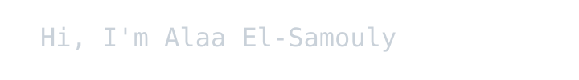

<!--  -->

**Obsessed and Working at [Charm](https://github.com/charmbracelet)** 

# Things I do:
- Full-stack web applications with Go, Bun/NodeJS and Nuxt (formerly React/Next)
- CLI/TUI tools using Go and [Charm](https://github.com/charmbracelet) ecosystem
- Mastering DSA on Go
- Building Discord bots with Go and JavaScript
- I use NixOS <3

## Noted projects:
- [Spin](https://github.com/sam0uly/spin): A universal project scaffolder.
- [Bub](https://github.com/sam0uly/bubbleMonitor): A glamourous tui system monitor.
- [Mditor](https://github.com/sam0uly/mditor): A terminal markdown editor, obsidian compaitable.
- [Sitch](https://github.com/sam0uly/sitch): A grid based and blazingly fast system information fetch CLI.
- Soon `Mural`: A wallpaper engine (daemon) and TUI wallpaper manager/viewer!

***You can find more about me [here](https://samouly.fun).***
